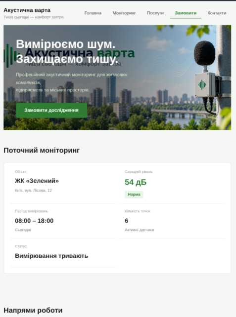
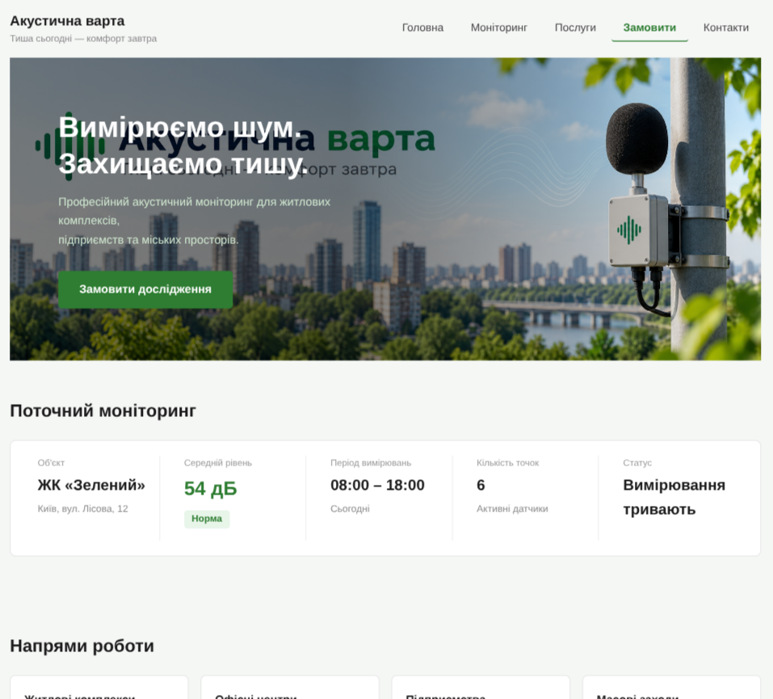
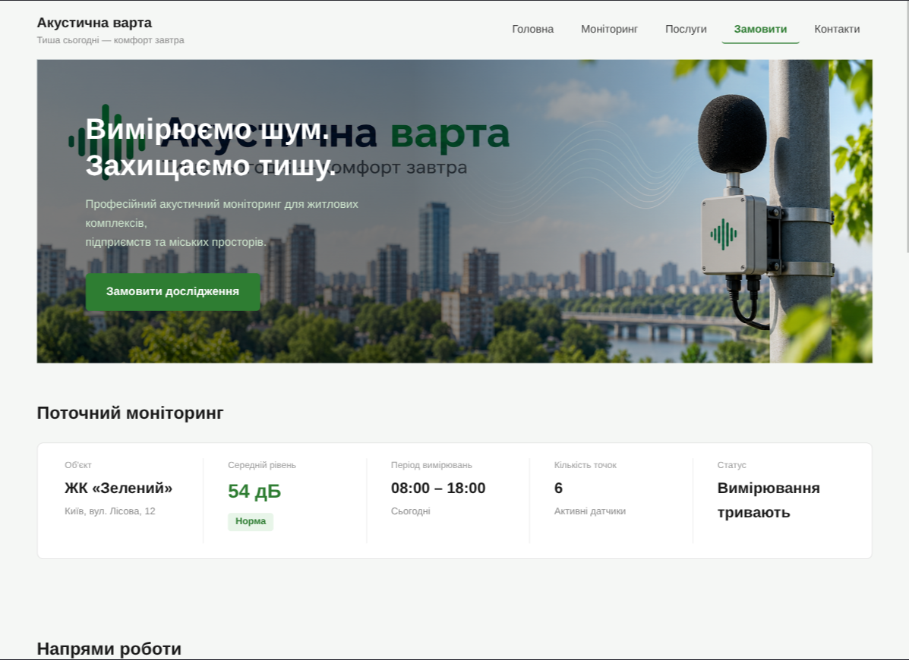

# Звіт до лабораторної роботи №3

## Тема

Адаптивна верстка вебсторінки за допомогою Flexbox, CSS Grid та препроцесора SCSS.

## Мета роботи

Набути практичних навичок перетворення вже створеної HTML/CSS-сторінки на адаптивний інтерфейс із використанням SCSS, Media Queries, Flexbox та CSS Grid на основі проєкту «Акустична варта».

## Виконання роботи

Стилі проєкту перенесено з CSS у SCSS та створено модульну структуру: `_variables.scss`, `_mixins.scss`, `_base.scss`, `_layout.scss`, `_components.scss`, `main.scss`. Модулі підключено через `@use` у файлі `main.scss`; legacy `@import` не використовувався.

У `_variables.scss` винесено всі повторювані значення: кольори, відступи (`$space-xs` — `$space-2xl`), розмір контейнера, радіуси та точки зламу (`$bp-tablet: 768px`, `$bp-desktop: 1024px`). У `_mixins.scss` визначено п'ять mixins: `respond-to` (медіазапит за `min-width`), `container` (fluid-контейнер через `min()`), `flex-center`, `flex-between` та `status-badge`.

Використано nesting глибиною не більше 3 рівнів. Додано `<meta name="viewport" content="width=device-width, initial-scale=1.0">` та застосовано підхід Mobile First: базові стилі — для вузького екрана, розширення — через `min-width`. Реалізовано три стани: Mobile (<768px), Tablet (768–1024px), Desktop (>1024px).

`header`, `nav` та `footer` побудовано через Flexbox: на mobile елементи розташовуються в колонку, на tablet і desktop — у рядок. На mobile навігаційні посилання приховано, щоб header залишався компактним.

Hero-секцію побудовано через CSS Grid; розмір заголовка змінюється плавно за допомогою `clamp(1.5rem, 5vw, 2.4rem)`. Сітка «Поточний моніторинг» перебудовується за схемою 1 → 2 → 5 колонок (CSS Grid). Сітка «Напрями роботи» — 1 → 2 → 4 колонки (CSS Grid); внутрішня структура карток реалізована через Flexbox.

Таблицю вимірювань вміщено в контейнер `.table-wrapper` з `overflow-x: auto` і задано `min-width: 580px` для самої таблиці — сторінка не отримує горизонтального скролу. Форму замовлення побудовано через CSS Grid: на mobile — одна колонка, на tablet — дві, на desktop — три поля в першому ряду.

SCSS скомпільовано в `css/main.css` за допомогою Sass CLI (`npx sass scss/main.scss css/main.css`). Адаптивність перевірено в DevTools (Device Toolbar) на ширинах 375px, 768px, 1024px та 1200px; горизонтального переповнення не виявлено.

## Структура проєкту

```
acoustic-watch/
├── index.html
├── assets/
│   └── images/
│       └── hero.png
├── css/
│   └── main.css
└── scss/
    ├── _variables.scss
    ├── _mixins.scss
    ├── _base.scss
    ├── _layout.scss
    ├── _components.scss
    └── main.scss
```

## Результат

Посилання на опублікований проєкт: https://vadumtarasenko1234-jpg.github.io/web-programming/lab3/
Скріншоти результату:

Mobile (375px):


Tablet (768px):



Desktop (1024px):



Desktop (1200px):



## Висновок

Під час виконання лабораторної роботи закріплено навички адаптивної верстки. Стилі проєкту «Акустична варта» перенесено на SCSS із модульною структурою, змінними та mixins, що дозволяє змінювати дизайн у центральному місці. Flexbox застосовано для одновимірних компонентів (навігація, header, footer, внутрішня структура карток), а CSS Grid — для двовимірних сіток (моніторинг, напрями роботи, форма). За допомогою Media Queries та підходу Mobile First забезпечено коректне відображення сторінки на mobile, tablet і desktop без горизонтального переповнення, що підтверджено перевіркою в DevTools.
