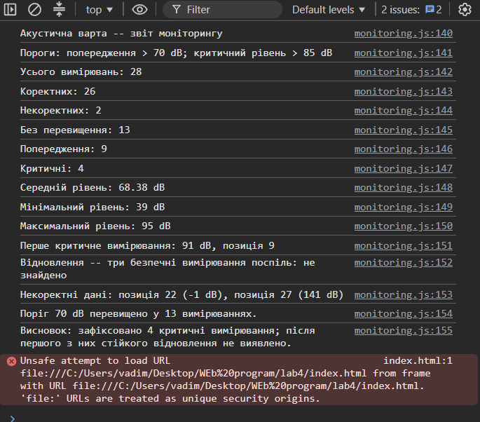

# Звіт до лабораторної роботи №4

## Тема

Робота з циклами, функціями та функціональними виразами в JavaScript. Консоль браузера.

## Мета роботи

Реалізувати алгоритм аналізу послідовності вимірювань шуму: від перевірки даних і циклів до декомпозиції на функції та синхронної передачі функції як аргументу на основі проєкту «Акустична варта».

## Виконання роботи

- створено файл `js/monitoring.js` і підключено до `index.html` через `<script src="./js/monitoring.js" defer>`;
- реалізовано фільтрацію некоректних вимірювань через `for...of` з `continue` без використання `filter()`;
- підраховано кількість вимірювань у кожній категорії (без перевищення, попередження, критичні) через `for...of`;
- обчислено середнє, мінімальне та максимальне значення вручну без `Math.min`, `Math.max` та `reduce`;
- знайдено перше критичне вимірювання через цикл `for` з `break`;
- реалізовано пошук відновлення (три безпечні вимірювання поспіль після першого критичного) через `while`;
- реалізовано пошук першого коректного вимірювання через `do...while`;
- алгоритм декомпозовано на функції: `isValidLevel`, `calculateAverage`, `findMinimum`, `findMaximum`, `findFirstCritical`, `countByCategory`, `findRecovery`, `findFirstValid`;
- використано всі три форми запису функцій: Function Declaration (`findFirstCritical`), Function Expression (`countByCategory`), Arrow Function (`statusLabel`, `isAbove`);
- `countByCategory` отримує `isValidLevel` як callback-аргумент;
- звіт виведено через `console.log`.

## Структура проєкту

```
acoustic-watch/
├── index.html
├── assets/
├── css/
├── scss/
└── js/
    └── monitoring.js
```

## Результат

Посилання на опублікований проєкт: https://vadumtarasenko1234-jpg.github.io/web-programming/lab4/

Скріншот консолі браузера:



## Висновок

Під час виконання лабораторної роботи реалізовано алгоритм аналізу вимірювань шуму засобами JavaScript. Застосовано цикли `for...of`, `for`, `while` та `do...while` відповідно до умов задачі. Алгоритм декомпозовано на функції з параметрами та `return`; використано всі три форми запису функцій і передачу функції як аргументу. Реалізовано фільтрацію некоректних даних, підрахунок категорій, обчислення статистики та пошук критичних і відновлювальних подій. Звіт виведено у консоль браузера.
